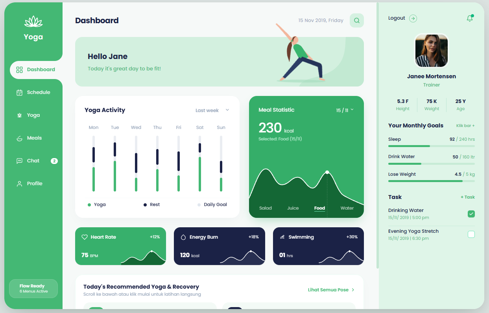

# Yoga & Fitness Dashboard

Template dashboard yoga dan kebugaran responsif dengan HTML, Tailwind CSS, dan JavaScript vanilla. Pengunjung bisa mencoba enam menu tanpa akun: Dashboard, Schedule, Yoga, Meals, Chat, dan Profile.

**[Buka demo di GitHub Pages](https://laluarifta.github.io/yoga_fitness_dashboard_app-/)**

## Preview



## Jalankan di lokal

Gunakan Node.js 22 atau lebih baru dan npm. Python dipakai hanya untuk server pratinjau di bawah; server HTTP statis lain juga bisa digunakan.

```sh
npm ci
npm run build
python -m http.server 4173 --directory dist
```

Buka <http://localhost:4173>. Jalankan ulang `npm run build` setiap kali mengubah sumber. Hasil build sudah berisi CSS, JavaScript, font, dan gambar; tidak perlu server aplikasi atau CDN saat demo dibuka.

## Struktur proyek

```text
.github/workflows/       # Publikasi GitHub Pages
  pages.yml
docs/images/             # Screenshot untuk README
scripts/                 # Penyiapan artefak statis
  build.mjs
src/
  index.html             # Markup dan enam tampilan dashboard
  images/                # Aset gambar runtime
  scripts/dashboard.js   # Data contoh dan perilaku interaktif
  styles/dashboard.css   # Gaya dashboard dan breakpoint
package.json
package-lock.json
tailwind.config.cjs      # Token merek dan sumber class Tailwind
```

Ubah konten di `src/index.html`, data contoh di `src/scripts/dashboard.js`, dan palet merek di `tailwind.config.cjs`. GitHub Pages menerbitkan isi `dist/`; untuk salinan repo, pilih **Settings → Pages → Build and deployment → Source → GitHub Actions**, lalu jalankan workflow **Deploy dashboard to GitHub Pages**.

Jadwal, nutrisi, profil, dan percakapan menggunakan data contoh. Perubahan hanya berlaku selama halaman terbuka, dan balasan chat disimulasikan di browser. Foto profil contoh berasal dari [Unsplash](https://images.unsplash.com/photo-1544005313-94ddf0286df2); Poppins disertakan dengan lisensi SIL Open Font License di hasil build.
